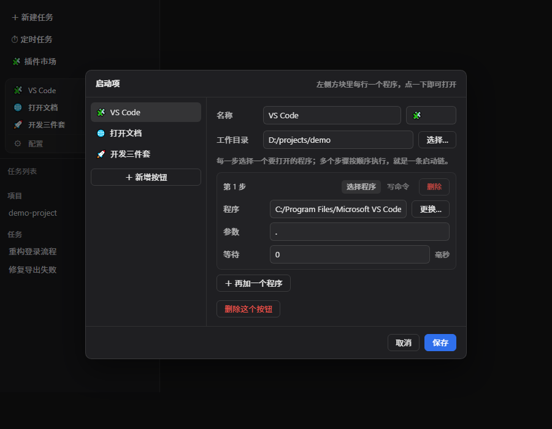

# ZCode App Launcher

在 ZCode 桌面客户端左侧栏「插件市场」下方、任务列表上方，加一个启动方块：点一下就打开某个软件，
或者按顺序拉起一整条软件链（编辑器 → 浏览器 → 终端……）。



> 这是对客户端 `app.asar` 的本地注入，属于非官方定制。安装前请阅读 [风险](#风险) 一节。

## 特性

- 竖排按钮：图标在左、名称在右，一行一个启动项
- 每步二选一：**选择程序**（文件选择框）或 **写命令**（cmd 命令行）
- 多步 = 启动链，每步可设置等待毫秒数
- **没有任何常驻进程**：点按钮时由 ZCode 主进程执行一次命令链，启动完即返回
- 配置保存在本地 `%APPDATA%\zcode-app-launcher\config.json`
- 卸载一条命令，注入前自动留字节级备份

## 工作原理

安装脚本往 ZCode 的 `app.asar` 里注入四个组件：

| 文件 | 作用 |
| --- | --- |
| `out/renderer/index.html` | 挂载启动脚本 |
| `out/renderer/zcode-app-launcher.js` | 左侧方块与配置面板 |
| `out/preload/index.cjs` | 通过 `contextBridge` 暴露三个 IPC 方法 |
| `out/main/index.js` | 读写配置、`spawn` 命令链 |

点击按钮时，渲染层调用 preload 暴露的桥，主进程读取配置并 `spawn` 命令；没有 HTTP 服务、
没有开机自启、没有后台常驻进程。

## 环境要求

- Windows 10 / 11
- Node.js 18+（`node -v` 能输出版本即可）
- ZCode 桌面客户端（在 3.18.x 上验证）
- 能完全退出 ZCode（托盘图标右键 → 退出）

## 安装

1. **完全退出 ZCode**（任务管理器里不再有 `ZCode.exe`）
2. 在仓库目录执行：

   ```bash
   node install.mjs
   ```

   安装脚本会：

   - 复制到固定目录 `%LOCALAPPDATA%\Programs\zcode-app-launcher`
   - 注入上面四个组件（先备份 `app.asar.launcher.bak`）
   - 之后的更新与卸载都指向这个固定目录，源码目录可以随意移动

3. 重新打开 ZCode，左侧栏即可看到启动方块。

### ZCode 正在运行时安装

直接执行 `node install.mjs` 不会失败：脚本会安排一个独立守候进程，等你**完全退出** ZCode 后自动
注入，写完自行退出。建议退出后等待约 15 秒再打开客户端，避免文件仍被占用。

取消待安装：

```bash
node uninstall.mjs --cancel
```

### 手动分步

```bash
node patcher.mjs --check    # 只读，查看四个组件状态
node patcher.mjs --apply    # 注入（需先退出 ZCode）
node patcher.mjs --revert   # 撤销注入（需先退出 ZCode）
```

ZCode 不在默认安装位置时：

```bash
node patcher.mjs --apply --asar "D:\Apps\ZCode\resources\app.asar"
```

## 使用教程

### 添加一个程序

1. 点方块底部的 `⚙ 配置`
2. 点左侧「＋ 新增按钮」
3. 填写名称、图标（任意 emoji）
4. 在第 1 步点「选择程序…」，从文件选择框里选中 `.exe`
5. 「保存」

回到侧栏，点这一行即可打开。

### 写命令

每一步顶部有「选择程序 / 写命令」切换。切到「写命令」后直接输入命令行，例如：

```text
code .
start "" "https://example.com"
"C:\Program Files\SomeApp\app.exe" --flag
```

命令由 `cmd.exe /d /s /c` 执行，所以 `start`、`explorer`、PATH 里的命令都可以直接用。

### 配置启动链

在同一个按钮里点「＋ 再加一个程序」，添加多个步骤即可。每步的「等待」表示发出这一步后，
隔多少毫秒再执行下一步。

例如「开发三件套」：

1. `code .`，等待 2000 ms
2. `start "" chrome.exe http://localhost:3000`，等待 1000 ms
3. `wt`

### 配置文件

配置也可直接编辑 `%APPDATA%\zcode-app-launcher\config.json`，结构见
[`examples/config.example.json`](examples/config.example.json)：

```json
{
  "buttons": [
    {
      "id": "vscode",
      "label": "VS Code",
      "icon": "🧩",
      "cwd": "D:/projects/your-project",
      "steps": [
        { "run": "\"C:/Program Files/Microsoft VS Code/Code.exe\" .", "delayMs": 0 }
      ]
    }
  ]
}
```

- `run`：启动该步骤的命令。选择程序时写成 `"完整路径"`，可再跟参数
- `cwd`：工作目录，留空使用用户主目录
- `delayMs`：执行下一步前的等待毫秒数（上限 15 秒）

## 常见问题

**方块显示「⚠ 启动器未就绪」**

说明注入没有完成或没有重启客户端。完全退出 ZCode 后重新打开；仍不行就执行：

```bash
node patcher.mjs --check
```

**ZCode 升级后按钮消失**

升级会整体替换 `app.asar`。重新执行 `node install.mjs` 即可。

**提示找不到 app.asar**

用 `--asar` 指定安装目录，或设置环境变量 `ZCODE_ASAR`。

**注入时提示文件被占用**

ZCode 没有退干净（托盘、后台进程）。完全退出后重试。

## 卸载

完全退出 ZCode 后：

```bash
node uninstall.mjs
```

会移除四个注入组件，并清理旧版本的遗留自启项。按钮配置保留在
`%APPDATA%\zcode-app-launcher\config.json`，不需要的话删除该目录即可。

## 风险

- 非官方修改客户端，ZCode 升级后需要重新注入一次
- 首次写入会在安装目录生成 `app.asar.launcher.bak` 备份
- 极少数安全软件可能拦截对安装目录的写入
- 方块依赖侧栏的 `sidebar-task-list-region` 锚点；官方大改侧栏结构时需更新
  `renderer/zcode-app-launcher.js`

## 开发与测试

无需安装依赖。

```bash
node --check patcher.mjs
node tests/make-asar.mjs _t.asar          # 构造一个结构合法的测试 asar
node patcher.mjs --apply --asar _t.asar --force
node patcher.mjs --check --asar _t.asar
node patcher.mjs --revert --asar _t.asar --force
```

## 目录结构

```text
.
├── patcher.mjs                  注入 / 检查 / 还原
├── install.mjs                  一键安装（含延迟安装守候）
├── uninstall.mjs                一键卸载
├── renderer/
│   └── zcode-app-launcher.js    左侧方块与配置面板
├── lib/
│   └── asar.mjs                 asar 读写与重打包
├── examples/
│   └── config.example.json      配置示例
├── tests/
│   └── make-asar.mjs            测试用 asar 生成器
├── docs/
│   └── screenshot.png
├── LICENSE
├── NOTICE.md
└── README.md
```

## License

[MIT](LICENSE)。asar 重打包逻辑改编自 [zcode-toolkit](https://github.com/c80361619/zcode-toolkit)（MIT），
详见 [NOTICE.md](NOTICE.md)。
